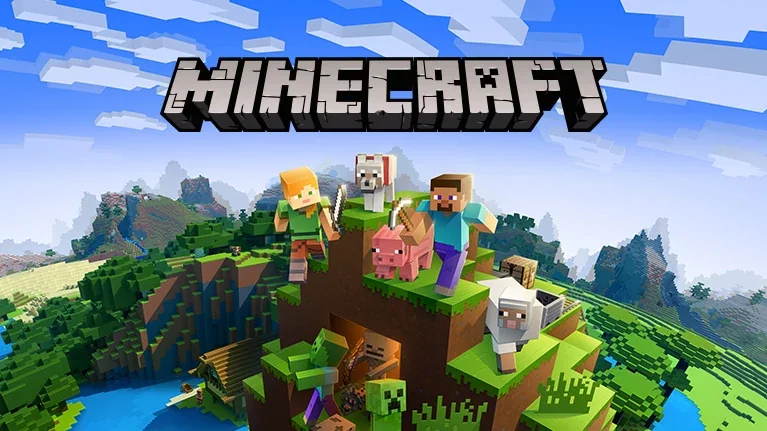
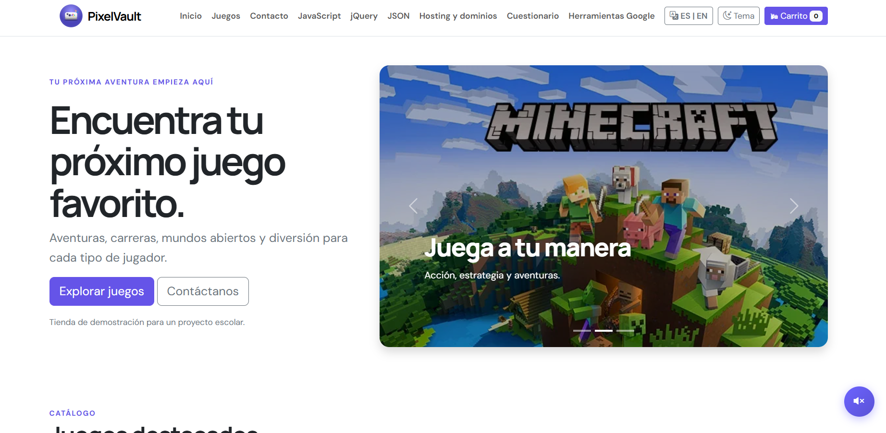

# 🎮 Portafolio de Proyecto Web: PixelVault

**Estudiante:** [Anderson Adiel Barahona Velasquez]  
**Fecha:** [Fecha de Entrega, ej. 16 octubre 2026]  
**Enlace al Sitio Web (Vercel):** https://pixelvault-original79.vercel.app/  
**Repositorio GitHub:** https://github.com/XadielX79/PixelVault-Original  

---

## 1. Identidad de Marca y Producto

### 📦 Ficha del Producto
* **Nombre Comercial:** PixelVault
* **Descripción:** Una tienda digital de videojuegos demostrativa que ofrece una experiencia de usuario moderna, con catálogo interactivo, carrito de compras funcional (simulado), sistema de traducción ES/EN y diseño totalmente responsive.
* **Público Objetivo:** Gamers, estudiantes de desarrollo web y entusiastas de la tecnología que buscan una interfaz limpia, intuitiva y visualmente atractiva.

### 🎨 Diseño Visual
* **Logotipo:**  
  

* **Paleta de Colores:**

* **Demostración del Carousel (Bootstrap):**  
   
    
     

---

## 2. Investigación Técnica

Resumen informativo de las subpáginas creadas para el proyecto:

1. **JavaScript (Vanilla):** Se utilizó para toda la lógica del lado del cliente, incluyendo el manejo del estado del carrito de compras (usando `Map`), la validación de formularios en tiempo real, la persistencia de preferencias (tema e idioma) con `localStorage` y la manipulación dinámica del DOM.
2. **jQuery:** Se exploró como una biblioteca histórica que simplifica la manipulación del DOM y las animaciones (como `fadeIn` y `slideToggle`). Se documentó su sintaxis, aunque se concluyó que JavaScript moderno puede realizar estas tareas de forma nativa y más eficiente.
3. **JSON:** Se implementó como el formato estándar para el intercambio de datos. Se demostró cómo estructurar información mediante pares clave-valor, objetos y arreglos para representar productos y configuraciones de manera legible para humanos y máquinas.
4. **Web Hosting y Dominios:** Se desplegó el proyecto utilizando **Vercel**, una plataforma ideal para sitios estáticos que ofrece HTTPS automático y despliegue continuo (CI/CD) conectado a GitHub. Se documentó la diferencia entre hosting (almacenamiento de archivos) y dominio (la dirección legible que apunta al servidor mediante DNS).

---

## 3. Integraciones Especiales

### 📬 Formulario de Contacto + Webhook de Discord
Explicación técnica del funcionamiento de la integración:
1. El usuario completa y valida el formulario de contacto en la interfaz web.
2. Al enviar, se previene el comportamiento por defecto y se ejecuta una petición HTTP `POST` asíncrona mediante `fetch()` en JavaScript.
3. Se envía un *payload* en formato JSON a la URL secreta del Webhook de Discord.
4. El servidor de Discord procesa la solicitud y despliega una notificación formateada (embed) inmediatamente en el canal configurado, sin necesidad de desarrollar un backend propio.

---

## 4. Anexos y Evidencias Gráficas

A continuación se presentan las capturas de pantalla obligatorias que demuestran el funcionamiento del proyecto:

1. **Vista General del Sitio (Home):**  
   
2. **Funcionamiento del Carrito de Compras:**  
   
   
3. **Página de las 15 Herramientas de Google:**  
   
4. **Comparativa Modo Claro / Modo Oscuro:**  
   
5. **Evidencia de Notificación en Discord (Webhook):**  
   
    

---

## 5. Conclusiones y Autoevaluación

* **Desafíos enfrentados:** 
  - Lograr que el sistema de traducción (ES/EN) fuera robusto, rápido y no dependiera de servicios externos inestables como widgets de terceros.
  - Asegurar que el diseño responsive (mobile-first) se mantuviera consistente y estético en todos los dispositivos, especialmente en el navbar y las tarjetas de productos.
* **Aprendizajes clave:** 
  - Consolidación de habilidades en manipulación del DOM y gestión de estado con JavaScript Vanilla.
  - Comprensión práctica de cómo integrar APIs externas (Webhooks) para conectar el frontend con servicios de terceros.
  - La importancia crítica de una documentación clara, estructurada y profesional en Markdown para presentar un portafolio de desarrollo competitivo.